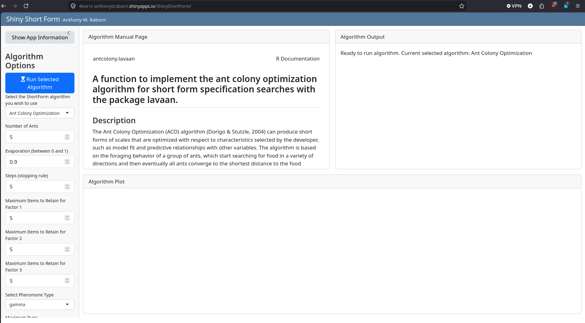

::: {.hero}
# Psychometrics and decision tools in R

I'm Anthony Raborn, a psychometrician and statistician. I work with testing programs, education agencies, and small medical practices on measurement, analysis, and planning questions. What you get back is something you can keep using: a report, a repeatable workflow, or a web app.

[Get in touch](contact.qmd){.btn .btn-primary}
[See the work](tools.qmd){.btn .btn-outline-secondary}

:::

[The record]{.rds-kicker}

:::: {.grid .rds-record}

::: {.g-col-12 .g-col-md-4 .rds-stat}
[9 years]{.rds-stat-num}

writing and maintaining psychometric software in R
:::

::: {.g-col-12 .g-col-md-4 .rds-stat}
[5 R packages]{.rds-stat-num}

for testing and measurement, 3 of them on CRAN
:::

::: {.g-col-12 .g-col-md-4 .rds-stat}
[1 product]{.rds-stat-num}

deployed, for direct care practices
:::

::::

The counts, dates, and papers behind these numbers are in the [interactive CV](cv/index.html){target="_self"}.

## What I do

:::: {.grid}

::: {.g-col-12 .g-col-md-4}
::: {.rds-card}
[Testing programs and education]{.rds-kicker}

### Assessment & Psychometrics

I work out whether a test measures what it claims to and whether it scores people fairly.

Item and form analysis, DIF, equating, standard setting support, technical reporting, and validity evidence.

[Example: fairness checks for small groups](posts/2026-11-11-small-group-dif/index.qmd)
:::
:::

::: {.g-col-12 .g-col-md-4}
::: {.rds-card}
[Analytics and research teams]{.rds-kicker}

### R/Shiny Decision Tools

I build the software around an analysis, so it runs the same way every time and people who do not write code can use it.

Shiny applications, Quarto reporting workflows, R package development, dashboards, and analytic automation.

[Example: shortening a scale](posts/2026-11-11-short-forms/index.qmd)
:::
:::

::: {.g-col-12 .g-col-md-4}
::: {.rds-card}
[Direct care and small practices]{.rds-kicker}

### Operations & Planning Models

I build models that answer money questions, such as when a practice will break even.

Break-even tools, capacity planning, pricing scenarios, and interactive models for service-based organizations.
:::
:::

::::

[More on each service](services.qmd)

::: {.decision-point}
**Decision point:** What I deliver is a tool, workflow, or report that helps someone make a clearer decision.
:::

## A working example

{fig-alt="Screenshot of the ShinyShortForm app, with algorithm options on the left and the manual page and output on the right."}

Most of the people who build tests do not write code. ShinyShortForm puts my ShortForm package behind a web page, so you can run the short form method without writing any R. [Try it on the Tools page.](tools.qmd)

## Who you would be working with

You work directly with me. I have a PhD in Research and Evaluation Methodology from the University of Florida, and the methods in my packages are published in peer-reviewed measurement journals.

[About me](about.qmd){.btn .btn-outline-secondary}
[Interactive CV](cv/index.html){.btn .btn-outline-secondary target="_self"}
